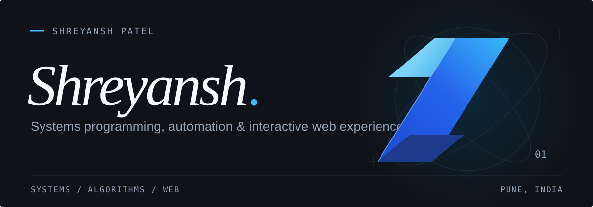
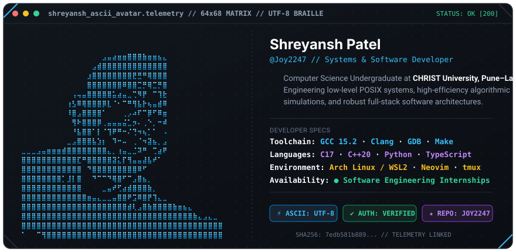
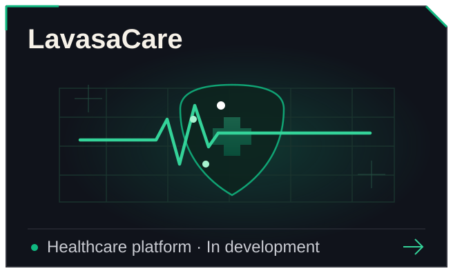
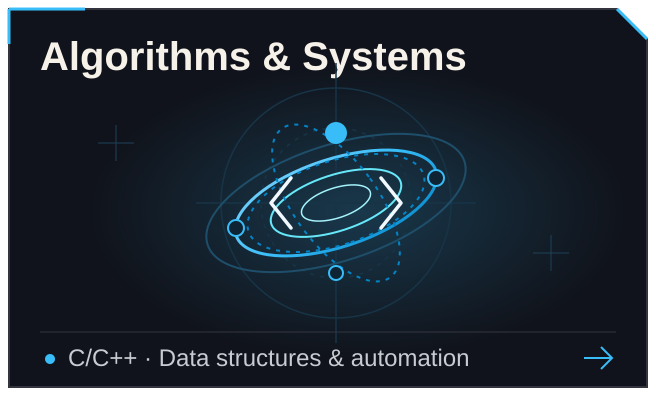
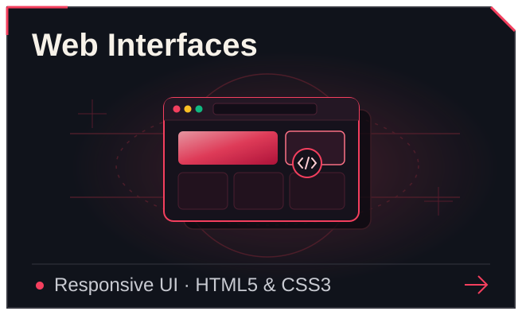

<p align="center">
  
</p>

## Shreyansh Patel

Computer Science student at **CHRIST University, Pune–Lavasa**. Focused on systems programming, algorithmic simulations, and building clean, performant full-stack software.

<p>
  <b><a href="https://github.com/Joy2247">GitHub ↗︎</a></b>
  &nbsp;&nbsp;·&nbsp;&nbsp; <a href="mailto:shreyansh2368@gmail.com">Email</a>
  &nbsp;&nbsp;·&nbsp;&nbsp; <a href="https://linkedin.com">LinkedIn</a>
  &nbsp;&nbsp;·&nbsp;&nbsp; <a href="https://leetcode.com">LeetCode</a>
</p>

<p align="center">
  
</p>

<details>
<summary><b>View High-Resolution Biometric ASCII Telemetry Card</b></summary>
<br>
<p align="center">
  
</p>
</details>

<p align="center">
  
</p>

## Developer Specification

```c
// shreyansh.c — Engineer Profile Configuration
#include <developer.h>

const Developer shreyansh = {
    .name        = "Shreyansh Patel",
    .handle      = "Joy2247",
    .affiliation = "CHRIST University, Pune–Lavasa",
    .focus       = SYSTEMS | ALGORITHMS | FULL_STACK,
    .languages   = { "C", "C++", "Python", "TypeScript" },
    .toolchain   = { "GCC", "GDB", "Make", "Git", "Linux" },
    .status      = "Ready for Software Engineering Internships"
};
```

## Selected projects

<p align="center">
  <a href="https://github.com/Joy2247/lavasacare-platform"></a>
  <a href="https://github.com/Joy2247/campus_learn"></a>
  <a href="https://github.com/Joy2247"></a>
  <a href="https://github.com/Joy2247/First-Website"></a>
</p>

<details>
<summary><b>Engineering details for these projects</b></summary>

- **LavasaCare Platform** — Full-stack healthcare service platform built with TypeScript, structured for clinic patient workflows, secure records management, and accessible appointment routing.
- **Campus Learn** — Student-centered educational resource sharing hub providing rapid access to course materials, categorized study guides, and peer notes.
- **Algorithms &amp; Systems** — Algorithmic problem solving and graphics simulations, including a real-time mathematical 3D torus rendering engine executing frame-by-frame projection loops in pure C/C++.
- **Web Interfaces** — Responsive frontend templates and semantic layout architectures engineered for multi-device parity with modern CSS3.

</details>

## Technical Arsenal &amp; Toolchain

**Low-level &amp; systems** &nbsp; `C (C11/C17)` `C++ (C++20)` `GCC` `GDB` `Make` `POSIX APIs`

**Scripting &amp; automation** &nbsp; `Python 3` `Bash` `Zsh` `PowerShell` `Regex`

**Web &amp; full-stack** &nbsp; `TypeScript` `JavaScript` `HTML5` `CSS3` `Tailwind CSS` `REST APIs`

**Environment &amp; tooling** &nbsp; `Linux / WSL2` `Git &amp; GitHub` `VS Code` `Neovim` `Alacritty` `tmux`

## Engineering Telemetry &amp; Metrics

<p align="center">
  
  
  <br/>
  
</p>

## More repositories

- [**Campus Learn**](https://github.com/Joy2247/campus_learn) — academic notes and community learning portal.
- [**LavasaCare Platform**](https://github.com/Joy2247/lavasacare-platform) — digital healthcare services prototype.
- [**First Website Showcase**](https://github.com/Joy2247/First-Website) — responsive web design showcase.
- [**Donut 3D Engine**](https://github.com/Joy2247/Joy2247) — 16-frame mathematical ASCII torus engine running in C.

---

**Contact:** [shreyansh2368@gmail.com](mailto:shreyansh2368@gmail.com) &nbsp; · &nbsp; Pune, India
