# Hi there, I'm Shreyansh 👋
### Computer Science Student | Problem Solver | Aspiring Software Engineer

<!-- ⚡ Animated Terminal & 3D ASCII Cube Showcase -->

  

---

### 👨‍💻 About Me
- 🎓 **Academics:** Computer Science / Engineering Undergrad.
- 💡 **Current Focus:** Data Structures & Algorithms using **C / C++** and problem solving.
- 🐍 **Scripting & Projects:** Building utilities, automation scripts, and applications in **Python**.
- 🌐 **Web Development:** Creating responsive, clean layouts using semantic **HTML5** and **CSS3**.
- 🌱 **Learning Goals:** Systems programming, algorithmic optimization, and clean software architecture.
- 💼 **Open to:** Software Engineering / Developer Internships & beginner open-source contributions.

---

### 🛠️ Languages & Tools

#### Languages

  
  
  

#### Web Markup & Styling

  
  

#### Tools & Environment

  
  
  

---

### 📊 GitHub Activity & Metrics

  
   
  

---

### 🚀 Featured Projects / Focus Areas

| Project / Focus | Tech Stack | Description |
| :--- | :--- | :--- |
| **Data Structures & Algorithms** | `C++` / `C` | Implementations and solutions to algorithmic problems focusing on time and space complexity. |
| **Python Utilities & Automation** | `Python` | Practical scripts and tools built to automate everyday tasks and explore data. |
| **Responsive Web Layouts** | `HTML5` / `CSS3` | Modern, responsive webpage templates and clean user interfaces. |

---

### 📬 Connect With Me

  
  
  
  

